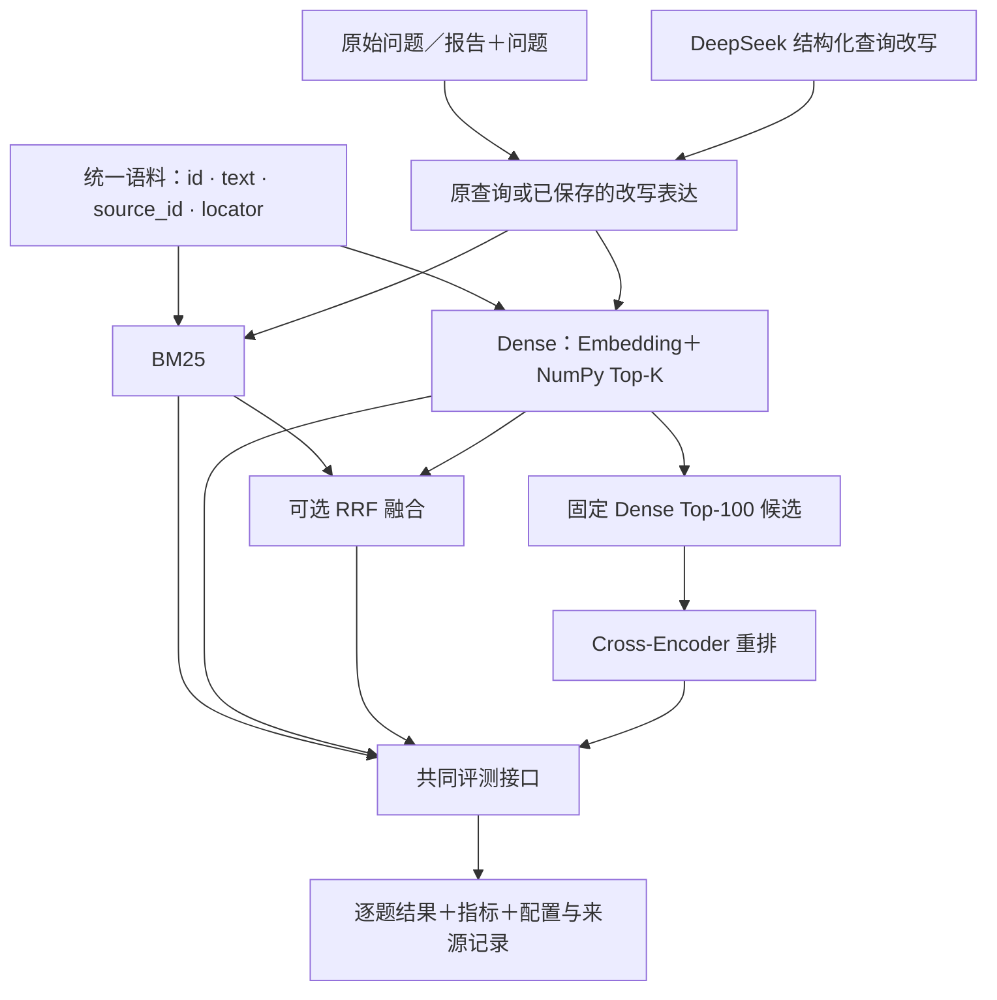

<h1 align="center">Clinical Evidence RAG</h1>

<p align="center"><strong>基于多源循证检索与多模态报告解析的医疗辅助决策系统</strong></p>
<p align="center">面向临床证据查询：找到依据、核对适用条件、定位原文，并说明还缺什么。</p>

<p align="center">
  
  
  
  
</p>

<p align="center">
  <a href="#overview">项目概览</a> ·
  <a href="#architecture">系统架构</a> ·
  <a href="#quickstart">快速开始</a> ·
  <a href="#evaluation">实测结果</a> ·
  <a href="#docs">文档导航</a> ·
  <a href="#roadmap">开发路线</a>
</p>

---

> **当前阶段 · 2026-11-27**：已完成医学语料构建、检索基线、固定候选重排及全量开发集查询改写对照；公开PubMedQA开发池500题无检索基线已实测，Accuracy 61.0%、Macro-F1 0.4708，RAG对照待完成。历史 CT 证据评估观察到任务范围与缺项判断错误，尚未解决。LangGraph 编排、报告 OCR、多模态对照和服务化仍待完成。

<a id="overview"></a>

## ✨ 项目概览

临床证据查询需要同时判断“材料说了什么”和“材料是否适用于当前问题”。同样是一份发现肺结节的胸部 CT 报告，筛查、偶发发现和检查目的缺失，会影响应该查阅的框架与需要确认的条件。

本项目从**报告与指南匹配**切入，逐步扩展到**药品说明书与医学文献核对**。目标是让每条判断对应可回查的证据，并区分三种情况：已有材料能够回答、病例条件需要确认、来源证据需要补查。

| 验证任务 | 重点检查 | 当前进度 |
|:---|:---|:---|
| **CT 报告与指南匹配** | 筛查／偶发场景、适用条件、必要澄清和证据位置 | 已有来源快照与原型联调；公开专项benchmark待选，自建题已退出评测 |
| **用药证据核对** | 正确产品、说明书章节、特殊人群与合并用药条件 | 已接入产品说明书；专项题与完整核验流程待完成 |
| **三类来源共同查证** | 区分指南推荐、产品说明和论文研究发现 | 已有多类语料；跨来源任务与补查流程待完成 |
| **报告多模态输入** | PDF／扫描件／截图的字段、数字、单位、否定词与原文位置 | 已有来源文档 HTML／电子 PDF 解析；报告 OCR 与配对评测待完成 |

<a id="features"></a>

## 🎯 核心设计与实现

| 设计重点 | 已有实现或实验 | 代码与记录 |
|:---|:---|:---|
| **多源数据与统一证据格式** | HTML、PDF、JATS、SPL 分别解析，统一保存证据 ID、来源身份及位置 | [数据处理流程](docs/data_acquisition_and_processing.md) · [解析模块](scripts/data/medical_corpus_parsing.py) |
| **可比较的检索策略** | 自行实现 Dense 相似度与 Top-K、BM25 检索封装、RRF 融合 | [Dense](retrieve_core.py) · [BM25](retrieve_bm25.py) · [RRF](retrieve_rrf.py) |
| **固定候选重排** | 在相同 Dense Top-100 上比较 Qwen3 4B／8B 与 BGE，保留原排名和候选身份 | [重排核心](rerank_core.py) · [候选加载](frozen_candidates_io.py) |
| **可选查询改写** | LangChain＋DeepSeek 结构化输出；BM25、Dense、RRF 共用原问题／改写对照入口 | [改写核心](query_rewrite.py) · [统一评测入口](run_benchmark_eval.py) |
| **单轮证据评估** | 结构化记录病例与证据缺口；18 项假响应检查及 3 题真实联调完成，语义错误继续保留与诊断 | [评估核心](evidence_review.py) · [联调记录](docs/medical_v3_bm25_baseline.md) |
| **向量缓存与恢复** | 按数据及模型配置识别缓存，分批提交，支持中断后继续编码 | [编码编排](embedding_index.py) · [缓存 I/O](embedding_cache_io.py) |
| **可回查的离线实验** | 保存逐题排名、原始问题、配置、指标、用量及运行记录，分别分析漏检与排序变化 | [评测核心](benchmark_eval.py) · [实测报告](docs/nfcorpus_retrieval_baselines.md) |

当前实验表明，**模型更大、增加 RRF 或增加改写，都需要在固定条件下验证**。例如，当前 BGE 重排降低了强 Dense 基线的排序指标，通用查询改写的收益也很小；这些负向结果与有效结果一起保留。

<a id="architecture"></a>

## 🏗️ 系统架构

下面是**当前已实现的离线检索与评测流程**。检索策略共用数据和评测接口，重排使用已固定的候选，查询改写可以独立开启。



**后续业务链路**：报告解析 → 证据检索 → 充分性与适用条件评估 → 必要追问／有限补查 → 回答生成 → 逐条结论与引用支持核验。LangGraph 将负责条件路由、调用预算和停止状态；单轮评估函数已完成接口与假响应验证，尚未接入完整图流程。

| 层次 | 当前使用 | 计划接入 |
|:---|:---|:---|
| 数据解析 | requests、BeautifulSoup、pypdf、XML 解析、JSONL | 报告 OCR／视觉模型，工具经样本对比后确定 |
| 检索与排序 | NumPy、rank-bm25、Sentence Transformers；LangChain HuggingFaceEmbeddings 接入 BGE／Qwen3 | Qdrant 索引与来源、地区、场景等元数据过滤 |
| LLM | LangChain、DeepSeek、Pydantic 结构化输出 | LangGraph 证据评估、追问、定向补查与停止 |
| 运行与交付 | Python CLI、文件缓存、逐题 JSONL／JSON 记录 | FastAPI、SQLite 评测记录、Docker 单实例 |

<a id="quickstart"></a>

## 🚀 快速开始

当前交付入口是 **CLI 检索评测**。以下命令用于已配置依赖的 Python 3.12 开发环境；本地已验证的环境名为 `all-in-rag`。主要依赖包括 pandas、NumPy、rank-bm25、pytrec-eval、PyTorch、Sentence Transformers、langchain-huggingface、langchain-deepseek 和 tqdm。完整依赖锁定与开箱部署属于后续交付项。

### 1. 获取代码与准备数据

```bash
# 获取项目代码。
git clone https://github.com/Herdeny/clinical-evidence-rag.git
# 进入项目目录。
cd clinical-evidence-rag
# 在本机已有该开发环境时激活它。
conda activate all-in-rag
# 从 BEIR 官方 Hugging Face 镜像准备 NFCorpus，并保存来源记录。
python -m scripts.data.prepare_nfcorpus --source huggingface
```

规范数据目录为 `data/external/nfcorpus/prepared/nfcorpus/`，包含 `corpus.jsonl`、`queries.jsonl` 和 `qrels/`。已有完整数据时，可用 `python -m scripts.data.prepare_nfcorpus --verify-only` 只做复验。

医学主语料的采集、解析、许可筛选与失败记录见[数据处理说明](docs/data_acquisition_and_processing.md)。`data/`、`cache/` 和 `results/` 默认不进入 Git，克隆代码不会自动取得本机语料、模型权重或实验原件。

### 2. 运行 BM25 开发集

```bash
# 使用项目缓存目录运行 BM25，结果保存到 results/。
bash scripts/project_env.sh python -u run_benchmark_eval.py \
  --method bm25 \
  --config configs \
  --data-dir data/external/nfcorpus/prepared/nfcorpus \
  --split dev \
  --run-name nfcorpus_bm25_dev_readme_01
```

该模式不调用生成 API，也不加载 Embedding 权重。每轮保存三份文件：`*_results.jsonl`（逐题结果）、`*_run.json`（文档排名）和 `*_summary.json`（汇总与配置）。同名输出存在时会拒绝覆盖，重跑请使用新的运行编号。

### 3. 切换 Dense、RRF 或改写对照

Dense 与 RRF 需要先准备配置中固定版本的模型快照。当前 Qwen3 配置使用 CUDA；模型与运行设置见 [Embedding 配置](configs/embedding_profiles.json)。包装脚本将 Hugging Face、Torch 等缓存放在项目 `cache/` 下。

| 目的 | 在 BM25 命令基础上调整 |
|:---|:---|
| Qwen3-Embedding-8B Dense | `--method dense --config-embedding-model qwen3_8b`，并更换 `--run-name` |
| BM25＋Qwen3 Dense RRF | `--method rrf --config-embedding-model qwen3_8b`，并更换 `--run-name` |
| 比较原问题和保存的改写 | 追加 `--rewrite-results <已保存的改写JSONL路径>`；同一入口输出两组结果 |

改写对照复用保存记录，不会在检索过程中重新请求 API。生成改写记录的入口是 [run_query_rewrite_batch.py](run_query_rewrite_batch.py)，需要可用的 DeepSeek 配置与凭证。固定候选重排使用 [run_reranking_eval.py](run_reranking_eval.py)，完整准备与运行步骤见[重排说明](docs/reranking_runtime_task.md)。

CT 任务使用原 [run_retrieval_eval.py](run_retrieval_eval.py)，已增量支持 `--review`、`--config`、`--profile` 与 `--result-dir`。开启后逐题评估检索证据，分别保存检索／评估耗时、失败记录及已知用量；关闭时运行纯检索。已完成 3 题真实联调，结构化返回成功，仍观察到过度追问和适用条件判断问题；业务效果尚未通过验证。

<a id="evaluation"></a>

## 📊 实测结果与口径

以下结果均来自本项目实际运行与离线复核。**NFCorpus 检索排序、CT 证据覆盖和 MIRAGE 问答准确率是不同任务，分别报告。**

### NFCorpus：检索与模型对照

固定 **3,633 篇文档、324 条 dev 查询**，使用配套 qrels；全部查询计入均值，未运行官方 test。下表 RRF 使用两路各 Top-100、融合常量 60。

| 方法 | nDCG@10 | Recall@10 | nDCG@100 | Recall@100 |
|:---|---:|---:|---:|---:|
| BM25 | 0.265738 | 0.110192 | 0.217934 | 0.205678 |
| BGE-small Dense | 0.327186 | 0.149011 | 0.297283 | 0.315082 |
| BM25＋BGE-small RRF | 0.312468 | 0.140675 | 0.281379 | 0.300335 |
| **Qwen3-Embedding-8B Dense** | **0.392196** | **0.192203** | **0.370125** | **0.397097** |
| BM25＋Qwen3 Dense RRF | 0.327825 | 0.160792 | 0.318641 | 0.364271 |

当前两组 RRF 均未超过各自的 Dense 基线，保留融合能力与负向结果。

### NFCorpus：固定候选重排

统一使用原 Qwen3 Dense Top-100，保持问题、文档和候选集合一致。模型在 RTX 4090 上运行，使用 BF16；下表时间只包含**候选读取与新增重排阶段**，不代表端到端延迟。

| 重排配置 | nDCG@10 | Recall@10 | Recall@100 | 平均每题新增耗时 |
|:---|---:|---:|---:|---:|
| Qwen3-Reranker-4B，batch=1 | 0.409974 | **0.206984** | 0.397097 | 3.258 s |
| Qwen3-Reranker-4B，batch=4 | 0.407701 | 0.205120 | 0.397097 | 3.236 s |
| Qwen3-Reranker-8B，batch=4 | **0.416582** | 0.202992 | 0.397097 | 5.430 s |
| BGE-reranker-v2-m3，batch=4 | 0.329419 | 0.147297 | 0.397097 | 0.268 s |

Qwen3 8B 重排相对原 Dense 的 nDCG@10 提升 **6.22%（相对值）**；4B batch=1 的 Recall@10 更高。BGE 重排在当前候选与配置下使两项头部指标下降。重排没有增加候选，因此所有配置的 Recall@100 保持不变。

### NFCorpus：全量查询改写对照

同一批 324 道开发题、同一份保存的改写记录，分别运行三种检索方法。仅 **12 条表达发生变化，312 条原样保留**。

| 方法 | nDCG@10：原问题 → 改写 | Recall@100：原问题 → 改写 |
|:---|---:|---:|
| BM25 | 0.265738 → 0.267019 | 0.205678 → 0.205261 |
| Qwen3 Dense | 0.392196 → 0.392264 | 0.397097 → 0.397362 |
| BM25＋Qwen3 RRF | 0.327825 → 0.328678 | 0.364271 → 0.364148 |

当前通用改写的收益很小且不一致。Dense 原有 32 道零召回题均未被改写，改写后仍为零召回；保留原查询默认与改写可选路径，下一步研究针对证据缺口的补查。

完整四指标、逐题变化、资源范围及原始运行标识见 **[NFCorpus 实测报告](docs/nfcorpus_retrieval_baselines.md)**。报告保留了一份历史预检资源文件被覆盖的异常与调查范围，不声称全部历史原件持续完整。

### PubMedQA 开发集无检索基线

独立公开专家CV池全部500题，DeepSeek Flash，无检索、不给定context；用户亲自运行，原始响应与离线评分已核对。

| Accuracy | Macro-F1 | 正确／总题数 | 接口及结构化失败 | 总tokens | 整进程时间 |
| ---: | ---: | ---: | ---: | ---: | ---: |
| 61.0% | 0.470773 | 305／500 | 0 | 296513 | 7分53.74秒 |

始终选yes的同池统计基线为55.2%；maybe类55题仅答对7题，类别表现见[详细记录](docs/benchmark_scope.md#pubmedqa-closed-book-dev)。这是项目开发基线，MIRAGE最终7663题及同题RAG对照尚未运行。

### 历史CT原型记录

此前使用自建合成CT题完成过医学主语料检索及少量核验联调，记录保存在 [BM25 归档](docs/medical_v3_bm25_baseline.md)与 [Dense 归档](docs/medical_v3_dense_baseline.md)。这些题不是公开benchmark，现已退出正式评测，不用作模型或方法效果依据；120题新运行计划已撤回。NFCorpus成绩也不能视为已在全部医学主语料或临床任务上验证。

<a id="data"></a>

## 🗂️ 数据与证据溯源

### 医学主语料 v3

| 来源 | 来源数 | 检索片段数 |
|:---|---:|---:|
| PMC 论文正文 | 9,836 | 480,538 |
| DailyMed 产品说明书 | 998 | 303,071 |
| CT 相关指南、推荐及证据摘要来源 | 6 | 238 |
| **合计** | **10,840** | **783,847** |

正文精确去重后为 **594,483 条不同内容**。同一成分的不同产品说明书保留产品身份，来源数、片段数、不同正文数和评测题数分别统计。

证据以 `id / text / source_id / locator` 为共同接口；来源记录进一步保存论文 PMCID／PMID／DOI、说明书 setID／版本，以及章节、页码、XPath 或字符范围。位置存在说明材料可回查，仍需检查是否支持具体结论。

### 公开评测基准

| 材料 | 规模 | 用途与状态 |
|:---|:---|:---|
| NFCorpus | 3,633 文档；324 dev 查询 | 已完成检索、重排与改写对照；官方 test 未运行 |
| MIRAGE | 7,663 道公开医学问答题 | 快照、五上游公开声明及全量／单任务读取已核验；完整问答链路和全量模型对标待完成 |
| PubMedQA 官方专家 CV 池 | 500 道题；yes／no／maybe | 已核对与 MIRAGE 的 ID／规范化题干及记录中参考 PMID 不重叠；无检索开发基线已实测，Accuracy 61.0% |

NFCorpus 使用其配套文档和 qrels；医学主语料用于项目业务验证；MIRAGE 保持独立，不把标准答案或给定支持上下文塞入检索。数据来源、许可筛选和处理边界见[语料调研](docs/medical_corpus_v3_research.md)、[采集处理](docs/data_acquisition_and_processing.md)与[对标要求](docs/benchmark_scope.md)。

评测只采用可公开核查的benchmark，并按其标注与协议报告对应能力。原180道CT合成题（120开发／60留出）仅保留历史记录，不属于当前评测集。报告澄清、引用支持、用药与多模态专项需另选匹配的公开benchmark，不能由上述两项成绩代替。

医学QA开发池500题标签分布为yes 276、no 169、maybe 55，无检索基线已完成全部生成及评分。该池用于项目开发，不宣称原论文十折实验或语义主题完全隔离。当前在原入口复用检索构造，接入同题RAG对照，见[当前任务](docs/benchmark_scope.md#下一用户任务复用检索器构造)。

<a id="docs"></a>

## 🗺️ 从哪里继续阅读

| 目标 | 推荐入口 |
|:---|:---|
| 理解文件职责与当前模块 | [文件导航](docs/project_files.md) |
| 查看数据如何下载、解析和定位原文 | [采集与处理过程](docs/data_acquisition_and_processing.md) · [来源调研](docs/medical_corpus_v3_research.md) |
| 核对模型、检索与重排实测 | [NFCorpus 报告](docs/nfcorpus_retrieval_baselines.md) · [重排配置与运行](docs/reranking_runtime_task.md) |
| 理解查询改写及对照方法 | [改写任务与实现约定](docs/query_rewrite_task.md) · [统一评测入口](run_benchmark_eval.py) |
| 查看真实工程问题与面试复盘 | [工程问题记录](docs/engineering_issues.md) |
| 确认最终交付与基准要求 | [对标范围与验收](docs/benchmark_scope.md) |
| 接续开发、了解背景与合作约定 | [项目交接总记录](PROJECT_CONTEXT.md) |

<details>
<summary><strong>📁 展开项目目录</strong></summary>

```text
clinical-evidence-rag/
├── retrieve_core.py              # Dense 相似度与 Top-K
├── retrieve_bm25.py               # BM25 分词、构建与检索
├── retrieve_rrf.py                # RRF 融合及检索编排
├── rerank_core.py                 # 固定候选重排
├── query_rewrite.py               # 单题与批量结构化查询改写
├── embedding_adapter.py          # Embedding 模型构造与输出归一化
├── embedding_index.py            # 分批编码与缓存恢复
├── embedding_cache_io.py         # 向量缓存持久化
├── frozen_candidates_io.py       # 固定候选及来源核对
├── benchmark_data.py             # BEIR／MIRAGE 数据读取与查询适配
├── benchmark_eval.py             # 共同评测与配对对照
├── run_benchmark_eval.py         # BM25／Dense／RRF 评测入口
├── run_reranking_eval.py         # 固定候选重排入口
├── run_query_rewrite_batch.py    # 批量改写入口
├── configs/                      # 固定模型版本与运行配置
├── scripts/data/                 # 数据采集、解析、构建与核验
├── scripts/evaluation/           # 预检及离线结果核验
├── tests/                        # 模块与辅助 I/O 检查
├── docs/                         # 技术说明、实测和工程复盘
├── data/                         # 本地语料与评测数据，Git 忽略
├── cache/                        # 本地模型及向量缓存，Git 忽略
└── results/                      # 本地实验原件与运行记录，Git 忽略
```

根目录其余模块与职责见[文件导航](docs/project_files.md)。早期 Notebook 保留作学习记录，正式评测入口通过 Python 模块运行，不依赖 Notebook 状态。

</details>

<a id="roadmap"></a>

## 🧭 开发路线

| 状态 | 阶段 | 交付目标 |
|:---:|:---|:---|
| ✅ | 数据与检索基线 | 医学 v3 语料、Dense／BM25／RRF、向量缓存与共同评测接口 |
| ✅ | 重排与查询改写对照 | NFCorpus 完整 324 dev、固定候选模型比较、三方法改写对照与错误分析 |
| 🚧 | 证据充分性评估 | 结构检查与历史联调已暴露任务范围错误；匹配标注的公开benchmark待接入 |
| ⬜ | LangGraph 有限补查 | 根据缺口追问或定向检索，限制预算，保存停止原因 |
| ⬜ | 回答与引用支持核验 | 逐条医学结论关联证据，核对原文支持和适用条件 |
| ⬜ | 用药与跨来源任务 | 正确产品章节、指南适用条件与论文证据类型共同核对 |
| ⬜ | 报告多模态对照 | 文本／电子 PDF／扫描件／截图配对，验证字段与下游判断 |
| ⬜ | MIRAGE 全量对标 | 完成 7,663 题，比较无检索、基础 RAG 与改进 RAG，报告质量和成本 |
| ⬜ | 服务与可复现交付 | Qdrant、FastAPI、SQLite、Docker 单实例及完整运行说明 |

<a id="limitations"></a>

## 📌 当前边界

项目正式评测只采用可核查的公开benchmark，既有合成CT题已退出评测、仅保留历史。尚无临床有效性结论；通用检索排序成绩不能替代医学判断、引用支持率或临床评估。MIRAGE五上游公开声明已逐项核查，范围和归属条件见[基准记录](docs/benchmark_scope.md#mirage五个上游的发布条件与划分)；独立开发池及500题无检索基线已完成，最终7663题全量对照尚未完成。

已接入说明书与论文，不表示用药、跨来源核对已完成；电子 PDF 来源解析不表示报告 OCR 已完成。基础 RAG 曾在 Notebook 中联调，完整 Agent 回答链路、Web／API 服务和一键部署仍在路线图中。

第三方文本按各自来源条件使用。PMC 按既定许可筛选；DailyMed 产品标签与 ACR 等资料的获取、使用和再分发条件分别核查。代码可见、页面可访问和材料可公开分发是不同事项，详见[数据使用条件记录](docs/medical_corpus_v3_research.md)。

<a id="acknowledgements"></a>

## 🤝 参考与致谢

项目参考 [JEen-wang/Adaptive-rag 的固定版本](https://github.com/JEen-wang/Adaptive-rag/tree/2a12a62382a8c3ec033fa9a5b19b9b23b8780ab8)的检索分层、工作流、评测与交付组织方式；本 README 也借鉴其展示结构。当前核心检索、评测与改写逻辑在独立目录实现，具体代码分工见[文件导航](docs/project_files.md)。后续如复用源码，单独记录来源与改造。

感谢 [BEIR](https://github.com/beir-cellar/beir)、[NFCorpus](https://www.cl.uni-heidelberg.de/statnlpgroup/nfcorpus/)、[MIRAGE](https://github.com/gzxiong/MIRAGE)、[PMC](https://pmc.ncbi.nlm.nih.gov/) 与 [DailyMed](https://dailymed.nlm.nih.gov/) 提供研究工具和数据入口；各自代码、模型与数据的许可分别适用。
